# User interface design - Room Allocation module (Assessment 9)

**Course:** BCSE301P Software Engineering | **Module:** Room Allocation of the Hostel Management System

This document describes the interface **as implemented and running** in the shared application (`hms_app/`); every screen shown is a screenshot of the running application (index: [`../screenshots/INDEX.md`](../screenshots/INDEX.md)). Requirement IDs (`RA-xx`, `UI-xx`) are the shared IDs from `docs/requirements.csv`; the evidence per requirement is in [`requirement_traceability.md`](requirement_traceability.md).

## 1. Purpose of the module

The Room Allocation module lets hostel staff assign students to rooms, move or cancel assignments, and see which rooms have free beds; it lets students see their own room. Its interface must make these tasks quick for staff (admin, warden), read-only and safe for students, and impossible to misuse accidentally (no double allocation, no overbooking, no unconfirmed cancellation).

## 2. Users and requirements

| Role | What they do in the interface |
|---|---|
| Admin | everything a warden can do, plus add blocks, rooms and students |
| Warden | allocate, reallocate, cancel; search and filter allocations; view available rooms, rooms, students |
| Student | view available rooms; view own allocation |
| Accountant | sees only a dashboard (no allocation functions) |

**Functional requirements the interface supports**

| ID | Requirement |
|---|---|
| RA-01 | Admin and warden can allocate an available room to a student |
| RA-02 | Input is validated (required fields, existing student/room, valid dates in range, end date not before start) with clear messages |
| RA-03 | A student has at most one active allocation |
| RA-04 | Capacity is never exceeded; full/maintenance rooms refuse allocation; room status follows occupancy |
| RA-05 | An active allocation can be moved to a room with a free bed |
| RA-06 | An active allocation can be cancelled after confirmation |
| RA-07 | Allocations can be listed, searched, filtered (block, status) and paginated |
| RA-08 | Available rooms are listed (filter by block, optional full rooms) for admin, warden and student |
| RA-09 | A student can view only their own allocation |
| RA-10 | Role-based access to pages |
| RA-15 | Role-specific dashboards |
| RA-16 | Admin can add hostel blocks, rooms and students (validated, CSRF-protected, admin only) so a fresh installation can be populated |

**Interface requirements** (`UI-01`...`UI-06`): consistent layout and role-correct navigation; responsive without horizontal page overflow (320 px upwards); feedback and confirmation; accessibility basics; one POST logout control; no leaked markup and strict content-security policy. Full wording in `docs/requirements.csv`.

## 3. Navigation structure

```
Login
 └─ Dashboard (role specific)                    sidebar (all roles) + breadcrumb
     ├─ Allocations   (admin, warden)  ── New Allocation ── Reallocate (per row) / Cancel (per row, with confirmation)
     ├─ Available Rooms (admin, warden, student)
     ├─ Rooms          (admin, warden)  ── Add room / Add block (admin only)
     ├─ Students       (admin, warden)  ── Add student (admin only)
     └─ My Allocation  (student only)
 Logout (bottom of the sidebar, one control)
```

| Role | Sidebar items (verified by tests and in a real browser) |
|---|---|
| Admin, Warden | Dashboard, Allocations, Available Rooms, Rooms, Students |
| Student | Dashboard, Available Rooms, My Allocation |
| Accountant | Dashboard |

## 4. Screens

Common layout: dark sidebar with the product name, the role menu and the signed-in user with role badge; a top bar with page title and breadcrumb; the page content (messages appear at its top); a footer. Below 992 px the sidebar becomes a drawer opened with the hamburger button.

### 4.1 Login - `/auth/login`
Inputs: e-mail, password (with show/hide button); button **Login**. Errors appear above the form.

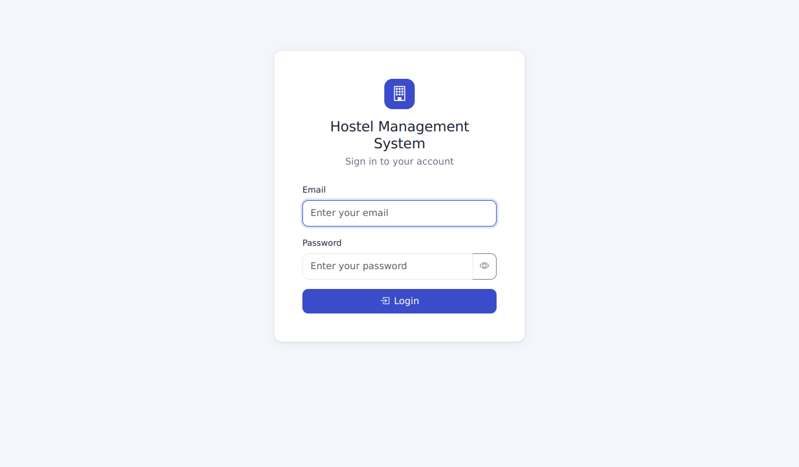

### 4.2 Admin dashboard - `/`
Output displays: four statistic cards (Total Students, Total Rooms, Occupied Rooms, Available Rooms), a bed-occupancy bar, **Quick Actions** (View All Allocations, Available Rooms, Manage Rooms, Manage Students), and a **Recent Allocations** table (Student, Room, Start, Status). Button: **New Allocation**.

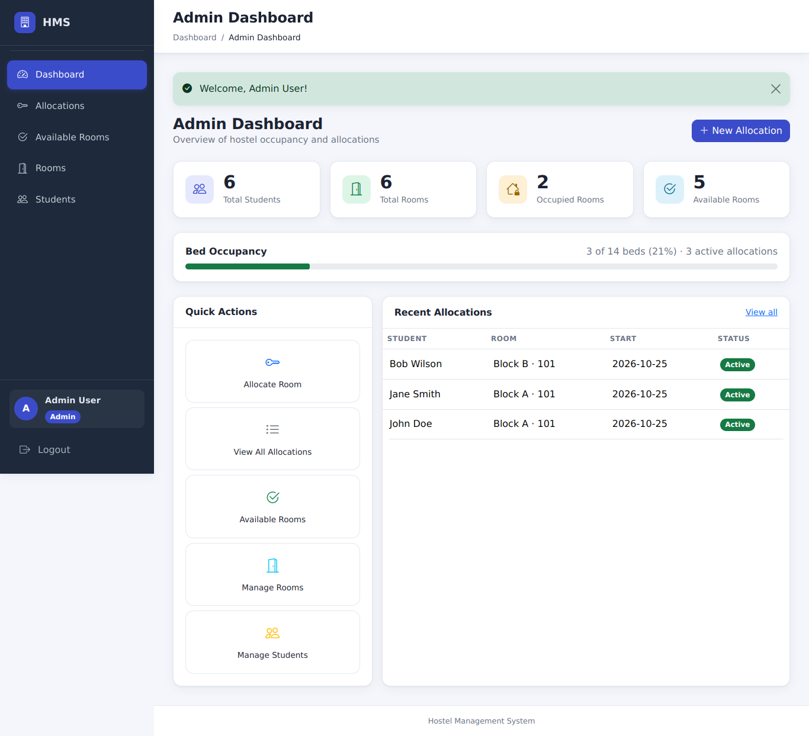

### 4.3 Allocation list - `/allocation/`
Inputs: search box, Block filter, Status filter; buttons **Filter** and **Clear**, **New Allocation**. Table columns: Student, Roll No, Room, Block, Allocated, Start, End, Status, Actions (**Reallocate**, **Cancel** icon buttons, shown for active allocations only). Pagination below 20 rows per page.

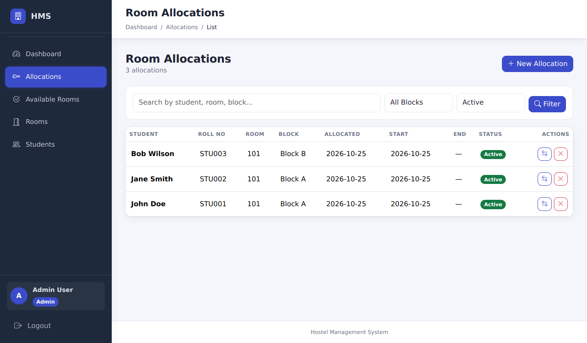

### 4.4 Create allocation - `/allocation/create`
Inputs: Student (required), Room (required, only rooms with a free bed), Start date (required), End date (optional). A live panel shows the chosen room's capacity, occupancy and free beds. Buttons: **Create allocation**, **Cancel**.

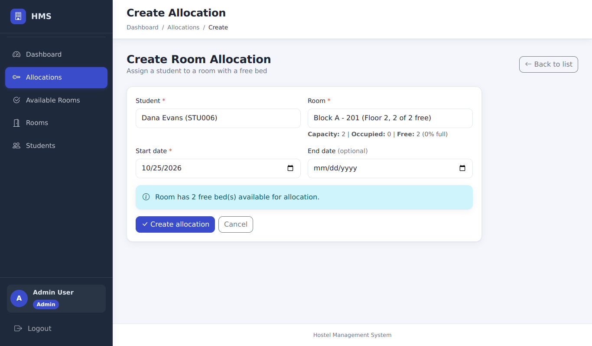

**Validation feedback** - errors from the server keep everything the user entered:

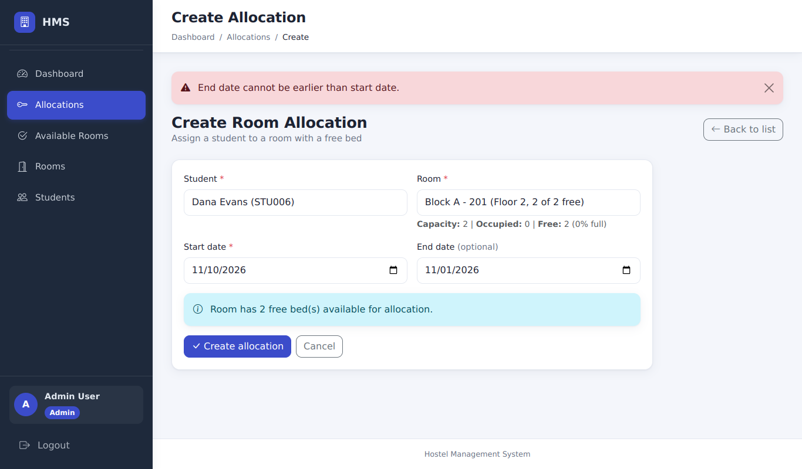
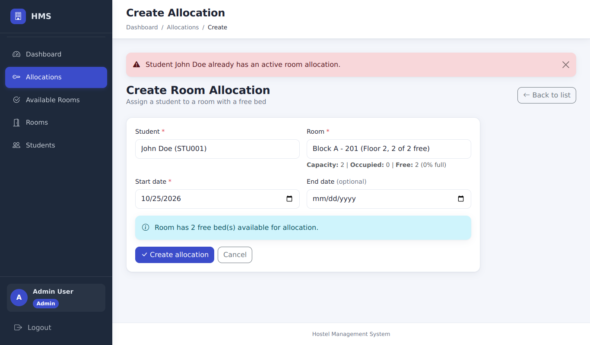

### 4.5 Reallocate - `/allocation/<id>/reallocate`
Input: New room (required; only rooms with a free bed). Buttons: **Reallocate**, **Cancel**.

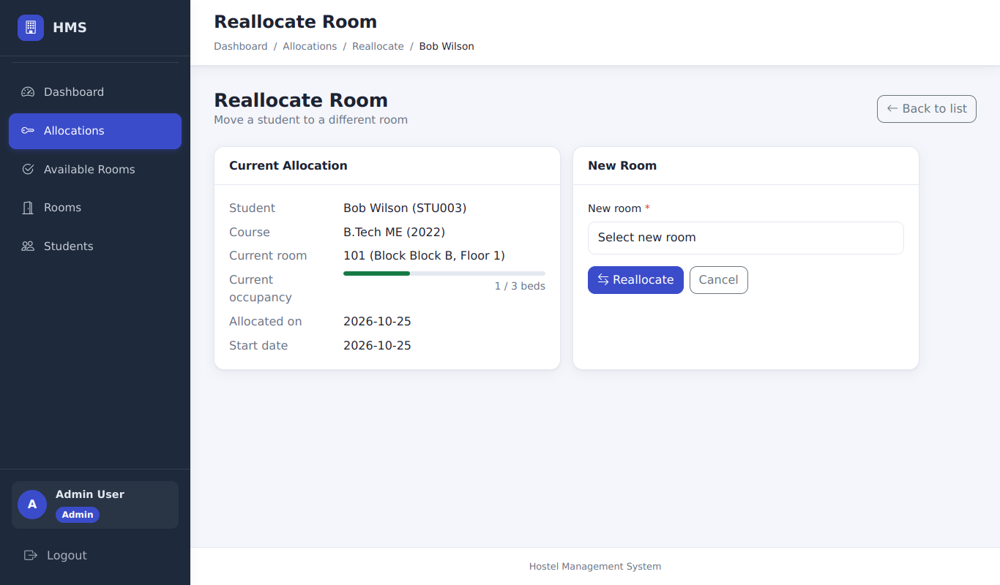

### 4.6 Cancel confirmation (modal)
Clicking the cancel icon opens a dialog with the question and the buttons **Go back** and **Confirm**; nothing happens until **Confirm**.

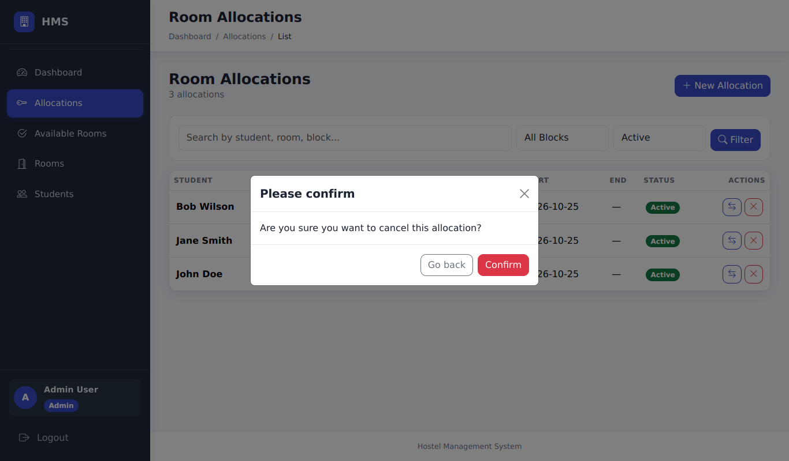

### 4.7 Available rooms - `/allocation/available`
Inputs: Block filter, **Show full rooms** checkbox (both apply immediately). Output: table of rooms with free beds (Room, Block, Floor, Capacity, Occupancy, Free beds, Status) and, optionally, the full rooms.

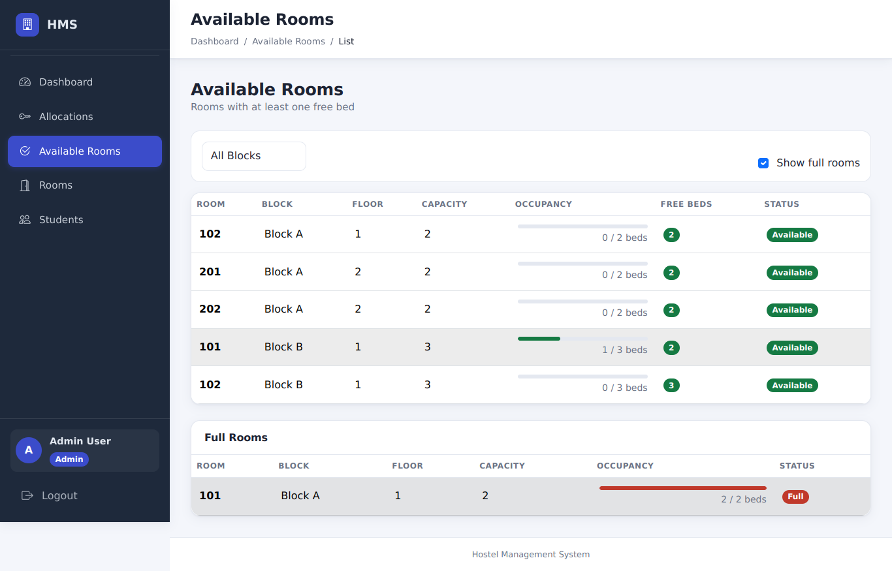

### 4.8 Rooms and Students - `/rooms`, `/students`
Tables for admin/warden. Rooms: Room, Block, Floor, Capacity, Occupancy, Available, Status. Students: Name, Email, Roll No, Course, Batch, Allocation. **Admins** additionally see the buttons **Add block**, **Add room** and **Add student**; wardens do not.

### 4.8a Data entry (admin only) - `/blocks/new`, `/rooms/new`, `/students/new`
- **Add block:** Block name (required), Location (optional).
- **Add room:** Block (required, existing blocks only; if there are none the form says so and links to Add block), Room number (required, unique within the block), Floor (0-50), Capacity (1-10 beds), Status (Available or Maintenance).
- **Add student:** Full name, E-mail, Roll number (all required), Course and Batch (optional), initial Password with confirmation (at least 8 characters; never echoed back into the page).

All three validate on the server with specific messages, keep the entered values on error, and need a CSRF token.

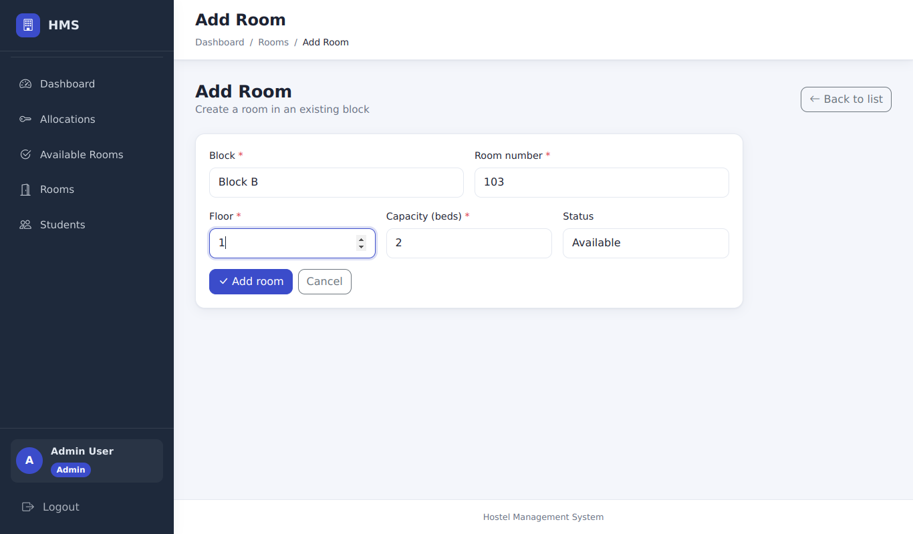
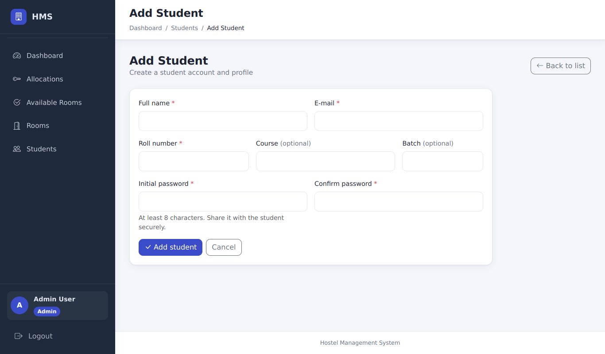
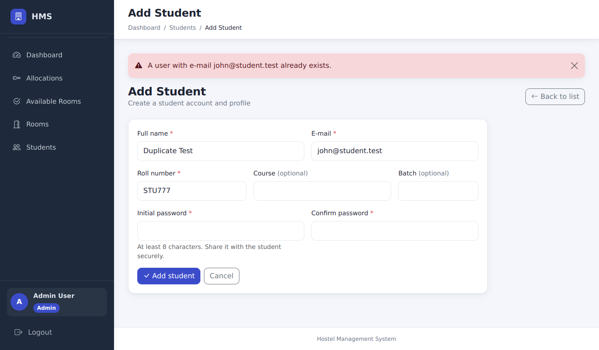

### 4.9 Student screens
The student dashboard (profile and room allocation summary with **View Details** / **View Available Rooms**) and **My Allocation** (room, block, floor, capacity, occupancy, allocated on, start, end, status).

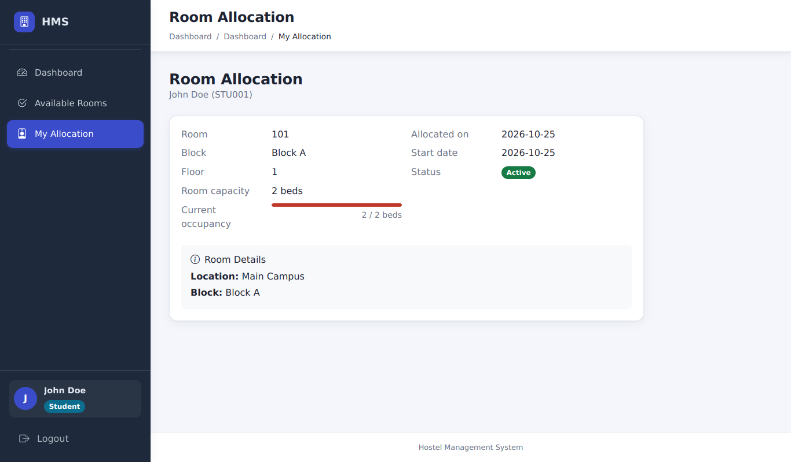

### 4.10 Warden and accountant dashboards
The warden dashboard shows a room-status table with **New Allocation** and **View Available**; the accountant dashboard is a placeholder page ("Fee Management").

### 4.11 Mobile (390 px)
Same screens; the sidebar is a drawer, tables scroll inside their card and the page itself never scrolls sideways.

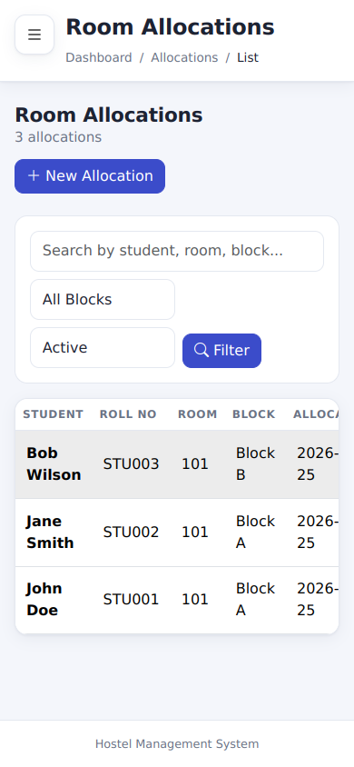
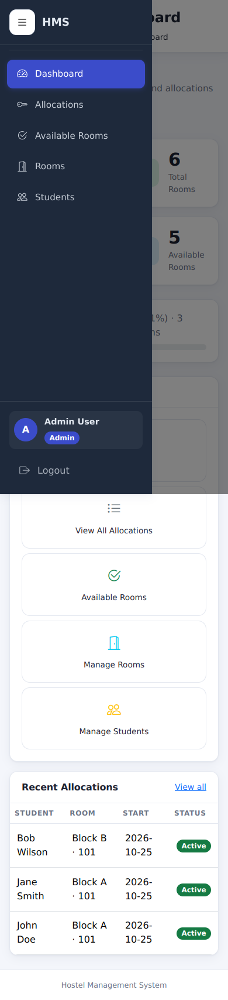

## 5. Design principles applied

| Principle | How it is applied | Evidence |
|---|---|---|
| **Simplicity** | One task per screen; forms have 2-4 fields; selects list only valid choices (rooms with free beds); optional fields are labelled "optional" | `test_create_form_only_offers_assignable_rooms`, `test_create_form_controls_are_labelled_and_required_where_needed` |
| **Consistency** | Same layout, sidebar, breadcrumb, buttons and badges on every page; one place for messages (top of the content); one logout control | `TestRoleBasedNavigation`, `TestSingleLogoutControl`, browser check "sidebar items" |
| **Usability** | Search/filter/pagination on the list; live availability panel; filters on Available Rooms apply immediately; role-correct menus so users never see actions they cannot use | `TestListBehavior`, `TestForms`, browser checks |
| **Feedback** | Success and error messages at the top of the page (checked to be visible without scrolling); errors stay until dismissed, success messages fade; validation errors keep the entered values; confirmation modal before cancelling; empty states ("No allocations found.") | `TestFeedback`, `TestConfirmationModal`, browser checks "error message is visible in the first screen", "error message persists...", "validation error keeps all entered values" |
| **Error prevention** | Required markers and browser validation; the server re-validates everything (dates, existence, one active allocation, capacity); destructive actions need confirmation and a CSRF token | `test_csrf.py`, `test_allocation_integrity.py` |
| **Accessibility** | Every control has a label; icon buttons have accessible names; the progress bar exposes `aria-valuenow/min/max`; visible focus outline; modal has `aria-labelledby` | `TestAccessibility`, `TestAccessibilityAndResponsiveMarkup` |
| **Responsiveness** | Viewport meta tag; drawer below 992 px; no horizontal page overflow at 320, 390, 768 and 1366 px; the hamburger never overlaps the title | browser checks "layout 320px / 390px / 768px / 1366px ..." |
| **Security in the UI** | Logout is a POST form with CSRF token; strict CSP (no inline scripts, assets self-hosted); no demo credentials on the login page by default | `test_security.py`, `TestSingleLogoutControl` |

## 6. How the interface supports interaction and satisfies the requirements

1. **Allocate (RA-01..RA-04).** Sidebar > Allocations > *New Allocation*. The student list contains all students; the room list contains only rooms with a free bed; the live panel shows capacity and free beds. On submit the server validates; success returns to the list with "Room N allocated to X successfully."; failure re-opens the form with the input preserved and a specific message.
2. **Reallocate (RA-05).** The row's *Reallocate* icon opens the form with only rooms that have a free bed; the result message names the new room and the Rooms page shows both rooms' occupancy updated.
3. **Cancel (RA-06).** The row's cancel icon opens the confirmation modal; *Confirm* cancels and frees the bed; cancelled rows (filter Status = Cancelled) offer no actions.
4. **Find (RA-07, RA-08).** Search, block and status filters and pagination on the list; block filter and *Show full rooms* on Available Rooms.
5. **Populate (RA-16).** On a new installation an admin adds blocks, rooms and students from the Rooms and Students pages, after which the allocation workflow above can be used end to end (covered by `test_empty_install_to_first_allocation_end_to_end`).
6. **Students (RA-09, RA-10).** A student's menu contains only Dashboard, Available Rooms and My Allocation; opening another student's allocation or any staff page redirects to the dashboard with a message.

## 7. Technology (shared code)

Flask + Jinja templates (`hms_app/templates/`), one stylesheet (`hms_app/static/css/hms.css`), Bootstrap 5.3.3 and Bootstrap Icons 1.11.3 **vendored** in `hms_app/static/vendor/` (no CDN), a small inline script per page protected by a per-request CSP nonce. The same application serves Assessments 8 and 9.

## 8. Verification performed

- Automated tests that parse the rendered HTML (`tests/test_ui.py`, `tests/test_ui_behavior.py`) - see the traceability table.
- A headless-Chrome run (`scripts/browser/verify_ui.mjs`; output in `browser_verification.txt`) at 320, 390, 768 and 1366 px: no horizontal overflow, no title overlap, drawer, POST logout, confirmation modal, validation, no CSP violations, no console errors.
- All screenshots were produced by `scripts/browser/capture_screenshots.mjs` from the running demo server.

## 9. Not verified / limitations

- **No usability test with real users** and **no automated accessibility audit tool** (such as axe) was run; the accessibility rows above are structural checks only.
- Browser coverage is headless Chrome only; Firefox/Safari were not tested.
- The manual UI cases (`UI-01`, `UI-02`, `UI-03`, `ALLOC-15`, `CANCEL-01/02` in the manual sheet) have **not** been executed by a person.
- The stylesheet also contains a dark colour scheme (follows the system setting) and print rules; neither is covered by tests or screenshots.
- Templates still use some inline `style` attributes, so the CSP allows inline styles (defect DEF-049).
- The accountant dashboard is a placeholder.
- Blocks, rooms and students can be added but not edited or deleted in the interface (DEF-053).
